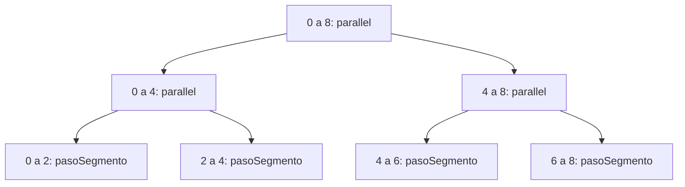

# Informe de paralelización

> **Antes de entregar:** revise las secciones 3 y 4, ajústelas con sus propias palabras y complete lo marcado `COMPLETAR`. Las explicaciones de los costos son hipótesis razonables; no se midieron por separado.

## 1. Estrategia de reparto

- **Dónde se reparte.** En los tres cálculos sobre $n$ partículas: `pasoParalelo`, `energiaParalela` y `centroDeMasaParalelo`. Cada partícula se calcula sin depender de las demás, y las magnitudes globales se obtienen combinando resultados parciales.
- **Con qué abstracción.** `parallel(tramoIzquierdo, tramoDerecho)` del paquete `common`: parte el tramo $[a,b)$ por la mitad en $\mu = a + \lfloor (b-a)/2\rfloor$ y resuelve las dos mitades a la vez.
- **Criterio para dejar de partir.** Cuando el tramo tiene a lo sumo `umbral` elementos se resuelve en secuencial con el mismo primitivo (`pasoSegmento`, o un `foldLeft` sobre el tramo). Un umbral igual o mayor que $n$ no reparte nada.
- **Operación que combina.**
    - `pasoParalelo`: concatenación `izq ++ der`, que conserva el orden. Es asociativa.
    - `energiaParalela`: suma de `Double`.
    - `centroDeMasaParalelo`: suma componente a componente del par (suma ponderada, masa); la división va una sola vez al final. Es asociativa con neutro $((0,0),0)$ (ver `correccion.md`).
- **Equidad de la comparación.** `pasoSecuencial` es `pasoSegmento(s, dt, 0, n)` y las hojas de `pasoParalelo` llaman a ese mismo `pasoSegmento`. Así, con `umbral = n`, ambas hacen exactamente el mismo trabajo y la aceleración debe dar $\approx 1$.

### El reparto en código

```scala
def pasoParalelo(s: Sistema, dt: Double, umbral: Int): Sistema = {
  val u = math.max(1, umbral)
  def rec(desde: Int, hasta: Int): Sistema =
    if (hasta - desde <= u) pasoSegmento(s, dt, desde, hasta)
    else {
      val medio = desde + (hasta - desde) / 2
      val (izq, der) = parallel(rec(desde, medio), rec(medio, hasta))
      izq ++ der
    }
  rec(0, s.length)
}
```

Cada mitad se resuelve sin mirar la otra: ningún índice aparece en las dos y ninguno se queda por fuera, porque un tramo va de `desde` a `medio` y el otro de `medio` a `hasta`. Para un sistema de ocho partículas con umbral 2, el árbol de llamados es:



## 2. Tabla de tiempos

- Máquina: `COMPLETAR` (modelo de CPU, RAM y sistema operativo; Windows).
- **Núcleos disponibles** (`Runtime.getRuntime.availableProcessors`): **12**, es decir $p=12$.
- Medición: se usó una medición propia en lugar de `withWarmer(new Warmer.Default) measure` para la tabla, porque ScalaMeter mide cada versión por separado y en nuestra primera corrida la fila de control, donde las dos versiones son iguales, dio 0,72, 1,35 y 1,02 en vez de 1. `App.scala` alterna `pasoSecuencial` y `pasoParalelo` en 21 corridas, libera memoria (`System.gc()`) antes de cada una, descarta las 4 primeras (calentamiento) y toma la **mediana** en ms. Alternar las dos versiones hace que el ruido de la máquina las afecte por igual; por eso el tiempo secuencial cambia un poco de fila en fila.
- *Aceleración estimada* $= n / T_p(n,u)$ con `tiempoEstimado` del punto 4. *Fracción serial* $=(p/S-1)/(p-1)$.

| n | umbral | t secuencial (ms) | t paralelo (ms) | aceleración medida | aceleración estimada | fracción serial (Amdahl) |
|---|---|---|---|---|---|---|
| 1000000 | 100 | 20,47 | 66,56 | 0,31 | 11,99 | 3,457 |
| 1000000 | 1000 | 18,24 | 58,91 | 0,31 | 11,86 | 3,432 |
| 1000000 | 10000 | 16,04 | 54,63 | 0,29 | 10,97 | 3,625 |
| 1000000 | 100000 | 14,58 | 19,32 | 0,75 | 6,86 | 1,355 |
| 1000000 | 1000000 (control) | 14,72 | 14,87 | 0,99 | 0,92 | 1,011 |
| 2000000 | 100 | 30,54 | 125,66 | 0,24 | 11,99 | 4,398 |
| 2000000 | 1000 | 30,34 | 117,35 | 0,26 | 11,93 | 4,129 |
| 2000000 | 10000 | 30,70 | 110,96 | 0,28 | 11,46 | 3,853 |
| 2000000 | 100000 | 28,91 | 43,29 | 0,67 | 8,73 | 1,542 |
| 2000000 | 2000000 (control) | 29,04 | 28,67 | 1,01 | 0,92 | 0,986 |
| 3000000 | 100 | 44,29 | 189,52 | 0,23 | 11,99 | 4,577 |
| 3000000 | 1000 | 57,43 | 184,33 | 0,31 | 11,96 | 3,411 |
| 3000000 | 10000 | 45,35 | 168,34 | 0,27 | 11,72 | 3,959 |
| 3000000 | 100000 | 45,38 | 68,93 | 0,66 | 8,73 | 1,566 |
| 3000000 | 3000000 (control) | 42,88 | 43,28 | 0,99 | 0,92 | 1,010 |

```scala
def medirPar(a: => Any, b: => Any): (Double, Double) = {
  def tiempo(f: => Any): Double = {
    System.gc()
    val t0 = System.nanoTime()
    val _ = f
    (System.nanoTime() - t0) / 1e6
  }
  def mediana(xs: List[Double]): Double = xs.sorted.apply(xs.length / 2)
  val corridas = List.fill(21)((tiempo(a), tiempo(b))).drop(4)
  (mediana(corridas.map(_._1)), mediana(corridas.map(_._2)))
}
```

**Control.** Con umbral igual a $n$ no se reparte nada y las dos versiones ejecutan el mismo `pasoSegmento`. La aceleración medida fue 0,99, 1,01 y 0,99, es decir 1 dentro del ruido. Por eso la comparación es confiable. (En una medición anterior, que no alternaba las corridas, el control daba 0,72, 1,35 y 1,02, y se descartó por esa razón.)

## 3. Comparación con la estimación del punto 4

El modelo es $T_p(n,u)=D(n,u)+n/p$. Con $p=12$ predice aceleraciones de 11 a 12 para los umbrales pequeños y de 7 a 9 para $u=100000$.

**En qué se parece.** En una sola cosa: la tendencia de los umbrales grandes. En los dos modelos, pasar de $u=100$ a $u=100000$ mejora la aceleración. En la medición sube de 0,23–0,31 a 0,66–0,75; en el modelo baja de 12 a 7–9 (el modelo penaliza el tramo secuencial que queda). Más allá de eso, no coinciden.

**En qué no se parece.** El modelo predice una ganancia grande y la medición da una pérdida en todos los umbrales: $0{,}23\le S\le0{,}75$ frente a $S\approx7$–$12$. Además, el modelo da 0,92 en el control cuando la realidad es 1, porque suma $n/p$ al tramo que no se partió (no divide el trabajo que no se repartió). Atribuyo la diferencia a costos que el modelo no cuenta:

- **Crear y esperar tareas.** El modelo da por gratis cada `parallel`. Con $u=100$ en un millón de partículas hay unas 10.000 hojas y más de 20.000 tareas.
- **Copias al concatenar.** `izq ++ der` copia los elementos en cada nivel del árbol: del orden de $n\log_2(n/u)$ copias que el secuencial no hace.
- **Memoria y recolector de basura.** Cada paso crea millones de objetos nuevos. Reservarlos y recolectarlos es parte del costo y no se reparte bien entre núcleos, además de saturar el ancho de banda de memoria.
- **Cálculo demasiado pequeño.** Cada partícula son unas pocas sumas y productos (menos de 20 ns), mucho menos que el costo de organizar el reparto.

Estas causas son hipótesis coherentes con los datos (el costo crece cuando el umbral baja, que es cuando hay más tareas y más niveles de copia), pero no las medí por separado.

## 4. Lectura de los resultados

1. **Umbral conveniente.** `COMPLETAR con sus palabras.` Entre los umbrales que sí reparten, el mejor fue $u=100000$ (aceleración 0,66 a 0,75), y entre más pequeño el umbral, peor. Ninguno superó al secuencial, así que en esta implementación y en esta máquina **el umbral conveniente es el que no reparte** ($u=n$, aceleración 1). Un umbral pequeño crea demasiadas tareas y copias, y uno muy grande deja núcleos sin trabajo; lo conveniente sería un valor intermedio que aquí no existe porque el costo fijo del reparto supera lo que ahorra el cálculo de cada partícula.
2. **Por qué la aceleración no crece al agregar núcleos.** Según la ley de Amdahl, si una fracción $f_s$ del cálculo no se reparte,

   $$S(p)=\frac{1}{f_s+\dfrac{1-f_s}{p}}\;\xrightarrow[p\to\infty]{}\;\frac{1}{f_s}.$$

   Aquí hay además un costo que **crece** con el reparto (tareas, copias, memoria). Por eso agregar núcleos o partir más no mejora: parte del tiempo se gasta en coordinar y en memoria, que no se divide entre núcleos. `COMPLETAR con sus palabras.`
3. **Fracción no repartida.** Con $f_s=(p/S-1)/(p-1)$ y $p=12$, el mejor umbral ($u=100000$) da $f_s\approx1{,}36$, $1{,}54$ y $1{,}57$ para 1, 2 y 3 millones. Una fracción mayor que 1 no es una fracción del cálculo: significa que el reparto **agrega** trabajo y no solo deja parte sin repartir. Lo que sí se puede decir es que, para este cálculo, prácticamente nada del tiempo se beneficia del reparto, y por eso $1/f_s<1$, es decir, no hay techo de ganancia sino pérdida.