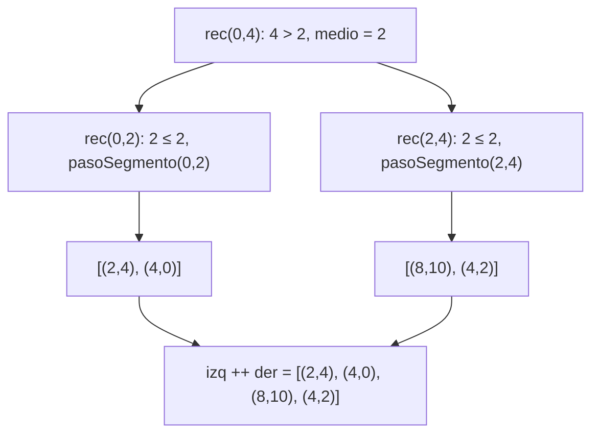

# Informe de proceso

Cómo se ejecuta cada función paso a paso. Todos los ejemplos son pequeños y se pueden seguir a mano.

Sistema de ejemplo, con $dt = 2$:

| índice | pos | vel | masa |
|---|---|---|---|
| 0 | $(0,0)$ | $(1,2)$ | $1$ |
| 1 | $(4,0)$ | $(0,0)$ | $3$ |
| 2 | $(2,2)$ | $(3,4)$ | $2$ |
| 3 | $(6,2)$ | $(-1,0)$ | $2$ |

## Punto 1: un paso de la simulación

### `pasoSegmento(s, dt, desde, hasta)`

Es la pieza básica. Crea un arreglo de $hasta - desde$ posiciones con `Array.tabulate`. La posición $i$ del resultado es la partícula `s(desde + i)` con `pos = pos + vel * dt`; velocidad y masa se copian sin cambio (`copy`). `desde` y `hasta` se acotan a $[0, n]$ para no salirse del arreglo.

Ejemplo: `pasoSegmento(s, 2, 1, 3)` produce 2 partículas:

- `s(1)`: $(4,0) + (0,0)\cdot 2 = (4,0)$
- `s(2)`: $(2,2) + (3,4)\cdot 2 = (8,10)$

### `pasoSecuencial(s, dt)`

Es `pasoSegmento(s, dt, 0, n)`. Se define así a propósito: la versión secuencial y la paralela usan **exactamente el mismo primitivo**, de modo que la diferencia de tiempos mide solo el costo del reparto.

### `pasoParalelo(s, dt, umbral)`

Con una función interna `rec(desde, hasta)`:

1. Si $hasta - desde \le umbral$, resuelve el tramo con `pasoSegmento`.
2. Si no, calcula `medio = desde + (hasta - desde) / 2`, lanza con `parallel` los dos tramos `[desde, medio)` y `[medio, hasta)`, y concatena los resultados en ese orden (`izq ++ der`).

Traza para el sistema de ejemplo ($n=4$) con `umbral = 2`:

Con `umbral = 1` cada tramo de 2 se vuelve a partir y salen 4 hojas de una partícula. Con `umbral = 4` no se parte nada: se llama una sola vez a `pasoSegmento(0, 4)`, que es justo lo que hace `pasoSecuencial` (la fila de control).

## Punto 2: magnitudes globales en secuencial

Todas son un `foldLeft` de izquierda a derecha.

- **`masaTotal`**: acumula `acc + p.masa`. Ejemplo: $1 + 3 + 2 + 2 = 8$.
- **`energiaSecuencial`**: acumula $\tfrac12 m\,\lVert v\rVert^2$. Ejemplo: $0.5\cdot1\cdot5 + 0 + 0.5\cdot2\cdot25 + 0.5\cdot2\cdot1 = 2.5 + 0 + 25 + 1 = 28.5$.
- **`centroDeMasaSecuencial`**: el acumulador lleva el par (suma ponderada, masa).
  Ejemplo: suma ponderada $= (0,0)\cdot1 + (4,0)\cdot3 + (2,2)\cdot2 + (6,2)\cdot2 = (0+12+4+12,\ 0+0+4+4) = (28, 8)$; masa $=8$; centro $=(28/8,\ 8/8) = (3.5,\ 1)$. Si la masa es 0 se devuelve el origen en vez de dividir.

## Punto 3: magnitudes globales en paralelo

Misma estructura de `rec(desde, hasta)` que `pasoParalelo`, pero el resultado de cada tramo se combina en vez de concatenarse.

### `energiaParalela`

Cada hoja devuelve la suma de energías de su tramo; cada nodo devuelve `izquierda + derecha`.

Traza con `umbral = 2`: `rec(0,4)` → hojas `[0,2)` = $2.5$ y `[2,4)` = $26$ → $2.5 + 26 = 28.5$.

### `centroDeMasaParalelo`

Cada hoja devuelve el **par** $(S, M)$ = (suma de pos·masa, suma de masas). Cada nodo combina sumando componente a componente. **La división ocurre una sola vez, en la raíz.**

Traza con `umbral = 2`:

| tramo | $S$ | $M$ |
|---|---|---|
| `[0,2)` | $(12, 0)$ | $4$ |
| `[2,4)` | $(16, 8)$ | $4$ |
| raíz | $(28, 8)$ | $8$ |

Centro $= (28/8,\ 8/8) = (3.5,\ 1)$, igual que el secuencial.

Si en vez de eso se promediara cada mitad: $(12,0)/4=(3,0)$ y $(16,8)/4=(4,2)$; su promedio $(3.5, 1)$ coincide aquí solo porque las dos mitades pesan lo mismo ($4$ y $4$). Con mitades de distinto peso el promedio de promedios falla (ver `correccion.md`).

## Punto 4: trabajo y profundidad

- `trabajo(n) = n`.
- `profundidad(n, umbral)`: función recursiva `rec(m)`: si $m \le umbral$ devuelve $m$; si no, $1 + rec(\lceil m/2 \rceil)$. Se sigue la mitad mayor porque es el camino crítico.

  Traza de `profundidad(1000, 100)`: $rec(1000) = 1 + rec(500) = 2 + rec(250) = 3 + rec(125) = 4 + rec(63) = 4 + 63 = 67$.
- `tiempoEstimado(n, p, umbral) = profundidad(n, umbral) + n / p`. Ejemplo: `tiempoEstimado(1000, 8, 1000)` $= 1000 + 125 = 1125$.

## Punto 5: aceleración

- `aceleracion(tSec, tPar) = tSec / tPar`. Ejemplo: $50/10 = 5$.
- `umbralConveniente(s, dt, umbrales)`: si la lista está vacía devuelve `s.length`. Si no, para cada umbral $u$ mide con ScalaMeter (`withWarmer(new Warmer.Default) measure`) el tiempo de `pasoParalelo(s, dt, u)`, arma pares $(u, t_u)$ y devuelve el $u$ del par con menor $t_u$ (`minBy`).